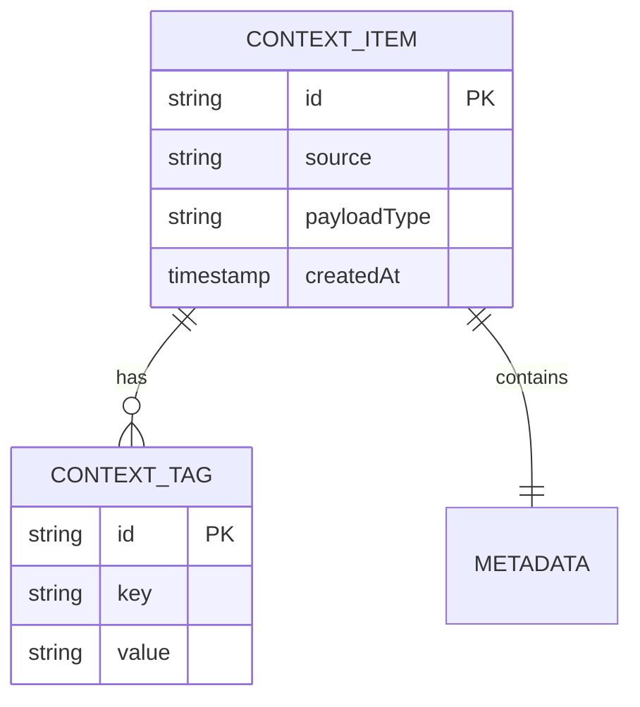

# Data Model: <Entity or Domain Name>

| Field | Value |
| :--- | :--- |
| Status | `Draft` \| `Proposed` \| `Accepted` \| `Deprecated` |
| Version | `1.0.0` |
| Datastore | MongoDB / PostgreSQL / Redis / In-Memory |
| Owner | Team / Engineer |
| Related API / ADR | Links |

## Conceptual Overview

Describe what this entity represents in the OneSquad business domain, lifecycle, and identity rules.

## Entity Relationship (ER) Diagram

## Schema Definition

### Fields Specification

| Field Name | Type | Required | Description | Constraints / Examples |
| :--- | :--- | :--- | :--- | :--- |
| `id` | `String` (UUIDv4) | Yes | Unique entity identifier | e.g. `f47ac10b-58cc-4372-a567-0e02b2c3d479` |
| `source` | `String` | Yes | Source system generating context | `<verified source identifier>` |
| `payload` | `Object` | Yes | Raw or normalized context payload | Valid JSON object |
| `createdAt` | `Timestamp` | Yes | Creation ISO timestamp | UTC |
| `updatedAt` | `Timestamp` | No | Last update timestamp | UTC |

## Indexing & Performance Guidelines

- Primary index: `id` (Unique, Hash or B-Tree)
- Query indexes: list of composite or secondary indexes and access patterns.
- Retention & TTL policy: if data has a time-to-live or cleanup routine.

