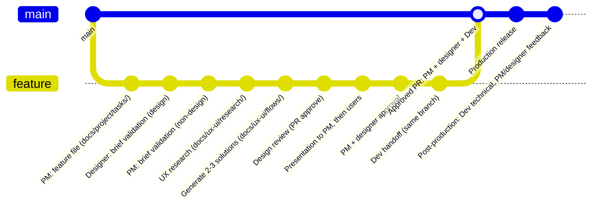

# The future Copilot process (V4): product designer journey

**Source status: in progress.** The note describes a monorepo workflow without Jira. Items marked “open” are unresolved.

> **Validate before adoption:** “Validated” labels below reflect the source note; no evidence of formal approval was provided. The cited RACI note (`gouvernance-raci-monorepo.md`, draft v0) was not provided with this document. Reconcile this journey with the [existing SDLC/BMAD workflow](./sdlc-bmad.md) and verify paths, roles, and rules before treating it as an active process.

## Steps

1. **New feature**: a validated need received by the PM (verbally or in a meeting).
2. **Track**: Build or Run, described as self-evident. Build = creating something that does not exist. Run = enhancing or changing something that already exists.
3. **Brief** in `product/`
   - Completed by the PM and pre-filled by the agent.
   - Missing field: for Build, block and ask a question in the linked GitHub issue. For Run, proceed with a clearly marked assumption.
   - Describes only the target state, not the current state.
   - The PM replies in the issue; the agent records the response in the brief in the same PR, subject to PM confirmation (an “approve” review).
   - If changes are requested, the agent updates the same PR without starting over.
4. **Step 4 (Run)**: investigate a user request; it guides the request if justified.
   **Step 4 (Build)**: user research (open: validate the “why not”; define the method).
5. **Design options**: open.
6. **Present** the solution to the PM and users. If approved, the PM validates the prototype for production.
7. **Development, QA, measurement**: open.

## Designer validation

- Covers the complete brief, before it is frozen.
- Rejection: open (who makes corrections, in the same PR or not).
- After it is frozen: track changes and restart only the affected step. The PM decides whether a research result is still valid.

## Discovery → generation → presentation (described as validated in the source)

- UX discovery: the designer alone decides when enough information is available to move to generation.
- Generation: 2 or 3 solutions from the agent.
- Selection: the designer validates the design and remains responsible for Decathlon standards; they may reject it. The PM challenges it; if the outcome does not meet the PM's needs, the designer starts again.
- Presentation: the designer presents in a session to the PM, then to users.
- Prototype validation for production: PM and designer validate it jointly.
- Unsuccessful presentation: repeat discovery or generation, depending on what was missing.

## Design-to-tech handoff (described as validated in the source)

- Design hands over a complete, ready-to-use package to development: mockup, prototype, specifications, business rules, and everything needed to develop without further questions.
- The technical phase begins afterward. It has not yet been described.

## After production (described as validated in the source)

- The designer follows up on user feedback after production.

## Open items

- Designer rejection: process and next steps.
- Design options: number, format, and validation.
- Development, QA, and measurement: all remain to be defined.
- Limit on restarting an earlier step.

## Monorepo interactions

Source cited: `gouvernance-raci-monorepo.md`, unvalidated draft v0. The paths and responsibilities in this table still need to be checked against the current repository structure and teams.

| Directory | Process use | Design | PM | Dev | Notes |
|---|---|---|---|---|---|
| `.github/ISSUE_TEMPLATE/` | Issue template linked to the brief | C | **A/R** | C | |
| `product/` | Brief (confirm: `product/` or `specs/`) | C | **A/R** | C | `specs/` = business requirements; `product/` = functional requirements |
| `docs/ux-ui/research/` | User research (Build) | **A/R** | C | I | |
| `docs/ux-ui/flows/` | User journeys, wireframes | **A/R** | C | C | |
| `docs/ux-ui/design-system/` | Tokens, accessibility, components | **A/R** | C | C | |
| `apps/mockup/` | Prototype | **A/R** | I | C | |
| `packages/ui/` | Shared UI components | **A** | I | R | Proposal, not validated (A or C?) |
| `.github/agents/design-agent.md` | Generation agent prompt | C | **A** | R | Changes reviewed by the PM |
| `docs/glossaries/product.md` | Product vocabulary | C | **A/R** | C | |

Unresolved in the RACI: Design as A for `packages/ui/`; owner of `docs/security/` and `docs/compliance/`.

## Decisions described as validated (design workflow step)

- The brief is the feature file itself, in `docs/project/tasks/`. The PM creates it from a template (template location: undefined).
- One feature = one file, tracked through completion. The PM updates it; Design, Dev, and QA may contribute.
- Questions about missing information are asked in the feature file.
- Brief validation: the designer validates the design portion; the PM validates the non-design portion.
- Each feature has a dedicated branch. The PM, designer, and developer work on the same branch.
- Research results go in `docs/ux-ui/research/` and are linked from the feature file.
- The agent generates 2 or 3 solutions in `docs/ux-ui/flows/`. A prototype in `apps/mockup/` is possible at this stage.
- Design validation: review the relevant files in a PR (approve) before presentation to avoid regressions in the final mockup.
- Presentation: PM, then users, before the merge.
- Merge into `main`: only work approved by the PM and designer and deemed technically feasible by Dev. Dev opens and approves the PR alone.
- After the merge, Dev resumes work on the same branch. Delete the branch once the feature is in production.
- Protect design folders with CODEOWNERS; the designer owns `docs/ux-ui/` and `apps/mockup/`.
- Changes to the final mockup: the designer formalizes the request, conducts UX research, scopes and generates the solution, then pushes the new version. The PM is informed of every change.
- Post-production: everyone is involved. Dev handles technical matters. The PM or designer handles user feedback. A user feedback item creates a new feature (complete flow; PM creates the file in `docs/project/tasks/`).

## Workflow (GitGraph)

Open: location of the feature-file template; designer rejection and restarting a step; QA in `docs/project/`; `packages/ui/`; owners of `docs/security/` and `docs/compliance/`.

