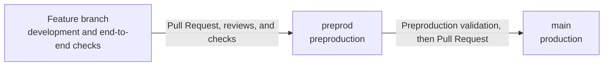

# Monorepo governance

## Purpose

The monorepo brings together applications and documents useful to different business areas. This organization supports collaboration and makes information easier to find.

To keep this information reliable, each area has an accountable team that maintains it and reviewers who check important changes before they are integrated.

> **Status: proposal to validate.** This content comes from the supplied `gouvernance.md` file (author and date unknown). The teams, access rights, paths in the matrix, branch rules, and checks described below are not confirmed by this document; verify them before adopting any of them.

## Teams

- **Dev**: develops and maintains applications, automation, and technical decisions.
- **Product Manager**: owns needs, priorities, specifications, and the roadmap.
- **Design**: owns user experience, mockups, user journeys, and the design system.
- **Run**: owns day-to-day operations, reliability, and support.
- **Security Officer (SO)**: owns project security.

## Governance matrix

The **owner** is the team responsible for keeping content up to date. **Required reviewers** check that a change is correct before it goes live. Another team may be consulted if a change affects its area.

| Area | Owner | Required review |
| --- | --- | --- |
| `.github/` | Dev | Dev |
| `apps/API/` | Dev | Dev |
| `apps/Front/` | Dev | Dev |
| `apps/mockup/` | Design | Design + PM |
| `project/roadmap/` | PM | PM |
| `product/specs/` | PM | PM + Dev + Design |
| `architecture/` | Dev | Dev + Run |
| `security/` | Security | Dev |
| `ux-ui/design-system/` | Design | Design + Dev |
| `ux-ui/flows/` | Design | Design + PM |
| `run/` | Run | Run + Dev |
| `glossaries/tech.md` | Dev | Dev |
| `glossaries/product.md` | PM | PM |
| `AGENTS.md` | Dev | Dev |

This matrix is a proposed way of working. The GitHub teams must be created or identified with the correct members. Additional review requests depend on the change; they do not mean that every team reviews every change.

## Who can read the information?

All areas of this repository are readable by Decathlon users who have access to GitHub. This rule applies to the whole repository; it does not vary by folder.

Therefore, a document that must remain confidential or restricted to a specific group should not be placed in these areas without defining an appropriate space. GitHub does not allow a folder to be hidden from some readers while they retain access to the rest of the same repository.

## CODEOWNERS and reviewers

A **Pull Request (PR)** is a proposed change submitted for review before it is integrated into the repository.

The **CODEOWNERS** file associates each area with its owning team. When a PR changes that area, GitHub can automatically request a review from that team. **Reviewers** check that the change is clear and correct within their area.

Repository rules can require approvals before a change is integrated. When multiple teams are listed in the matrix, the rules must be configured to require approval from each one. A review request is not, by itself, an approval.

**Key point:** CODEOWNERS helps identify the right reviewers; it does not control who can read the repository.

### Example `CODEOWNERS` file

This example uses the areas in the matrix. Replace `team-dev`, `team-pm`, `team-design`, and `team-run` with the actual GitHub team names in your organization.

The file should be placed at `.github/CODEOWNERS` in the repository root:

```text
# Applications and mockups
/apps/API/                 @dktunited/team-dev
/apps/Front/               @dktunited/team-dev
/apps/mockup/              @dktunited/team-design @dktunited/team-pm

# Documentation
/product/                  @dktunited/team-pm @dktunited/team-dev @dktunited/team-design
/architecture/             @dktunited/team-dev
/security/                 @dktunited/team-dev
/ux-ui/                    @dktunited/team-design
/run/                      @dktunited/team-run @dktunited/team-dev
/support/                  @dktunited/team-run @dktunited/team-dev
/glossaries/tech.md        @dktunited/team-dev @dktunited/team-run
/glossaries/product.md     @dktunited/team-pm @dktunited/team-design
```

Teams must exist in GitHub and have access to the repository to own code. When multiple teams appear on a line, they are requested to review; this does not automatically require each team to approve before merging.

## Branches and change promotion

The repository uses two permanent branches:

- **`main`** represents production. It contains changes deployed to production.
- **`preprod`** represents preproduction. It is used to integrate and validate changes before production.

Each feature is developed and verified end to end on its own branch, created from `preprod`. Once ready, it is submitted as a Pull Request and merged into `preprod` after the required reviews and checks. After validation in preproduction, the changes are promoted from `preprod` to `main` in a new Pull Request. Merging into `main` triggers or enables production deployment, depending on the repository configuration.



## Conventional Commits: naming changes

**Conventional Commits** provide a consistent way to write messages describing changes. The beginning indicates the change type and subject. Examples:

```text
feat(service-a): add order tracking
fix(api): correct status calculation
docs(product): clarify return rules
ci(workflows): validate proposed changes
design(mockup): update the order journey
```

Some common types:

- `feat`: a new feature or enhancement;
- `fix`: a bug fix;
- `docs`: a documentation update;
- `ci`: a change to automated checks;
- `design`: a design update.

An automated check should validate the format and prevent a non-compliant message from being integrated. This convention makes history easier to read and improves traceability.

## Automated checks

Automated checks can validate tests, proposed changes, and some documentation rules. They flag problems before integration and avoid repeating the same checks manually. Teams remain responsible for domain reviews.

## Summary

- Each area in scope has an owning team and identified reviewers.
- Decathlon users with GitHub access can read the entire repository.
- CODEOWNERS requests reviews from the right teams; it does not define read permissions.
- Features are developed on dedicated branches, merged into `preprod` for validation, then promoted to `main` for production.
- Conventional Commits make changes easier to understand and find.
- Automated checks help identify problems but do not replace human review.

